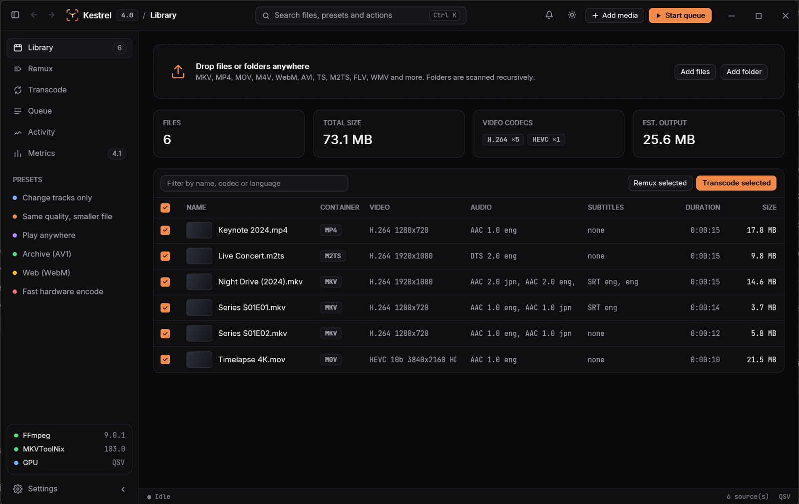
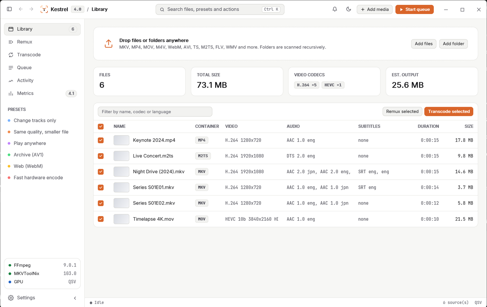
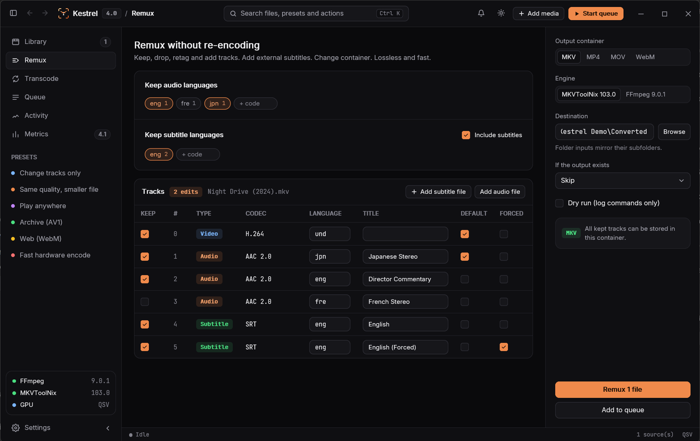
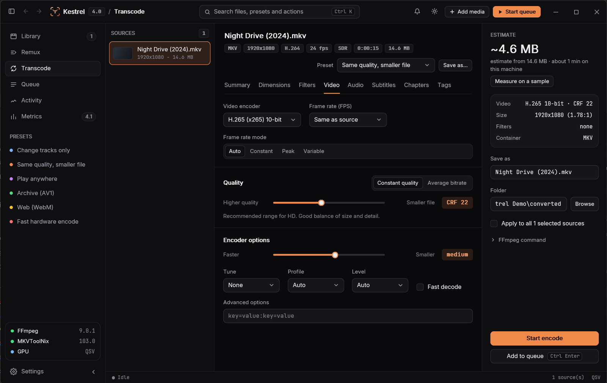
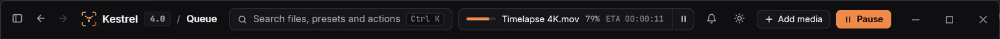

<div align="center">


# Kestrel

**Remux, add tracks and transcode video. Native, local, no upload.**

[](https://github.com/mlbkumar9/Kestrel/actions/workflows/ci.yml)
[](https://github.com/mlbkumar9/Kestrel/releases)
[](LICENSE)

</div>



Kestrel 4.0 is a desktop app written in Rust with the GPUI toolkit. It drives FFmpeg and MKVToolNix on your machine. Files never leave your disk.

Download Kestrel 4.0 from the [v4.0.0 release](https://github.com/mlbkumar9/Kestrel/releases/tag/v4.0.0), or [build it from source](#build-from-source). The [Download](#download) section says which file to pick.

## Download

Get the files from the [v4.0.0 release](https://github.com/mlbkumar9/Kestrel/releases/tag/v4.0.0). Pick one per system:

| System | File | Notes |
|---|---|---|
| Windows 11 | `Kestrel-v4.0.0-windows-x64.zip` | Unzip and run `Kestrel.exe`. FFmpeg and mkvmerge are bundled in the `tools` folder. |
| Windows 11 | `Kestrel-v4.0.0-windows-x64.msi` | Installer with the same bundled tools. |
| Windows 11 | `Kestrel-v4.0.0-windows-x64.exe` | The program alone. Install FFmpeg and MKVToolNix yourself. |
| macOS, Apple silicon | `Kestrel-v4.0.0-macos-aarch64.zip` | Ad-hoc signed, so Gatekeeper asks before the first launch. Uses FFmpeg and MKVToolNix from the system. |
| macOS, Intel | `Kestrel-v4.0.0-macos-x86_64.zip` | Same as above. |
| Linux | `Kestrel-v4.0.0-linux-x64.tar.gz` | Uses FFmpeg and MKVToolNix from the system. |
| Windows 11, earlier app | `Kestrel-v4.0.0-legacy-egui-windows-x64.zip` | The egui app, kept for reference. |

`SHA256SUMS.txt` lists the checksum of every file. Compare it with `Get-FileHash <file>` on Windows or `sha256sum <file>` elsewhere.

## What it does

- **Remux without re-encoding.** Keep or drop audio and subtitle tracks by language, then edit each track: language, title, default and forced flags. Video is copied bit for bit.
- **Add subtitles and audio.** Mux external SRT, ASS, SSA, VTT and SUP files, or audio files, into a container as new tracks.
- **Change containers.** Write MKV, MP4, MOV or WebM. Kestrel checks every track against the target container and tells you what will be dropped before you start.
- **Transcode with HandBrake-level controls.** Eight tabs (Summary, Dimensions, Filters, Video, Audio, Subtitles, Chapters, Tags) cover encoders, quality, crop, scaling, filters, HDR, per-track audio, burned-in subtitles and chapter names. FFmpeg does the work.
- **Queue and presets.** Add jobs to a queue, start, pause or stop it, and read every command in the Activity log. Five built-in presets plus your own, which you can rename, duplicate, delete, import and export.
- **Preview before you commit.** Encode a 15, 30 or 60 second segment with the current settings, read its size and extrapolated full size, and play it.
- **Batch.** Add files or whole folders. Folder inputs keep their subfolder layout in the output.

## A closer look

| | |
|---|---|
|  |  |
| **Library.** Drop files or folders, see containers, codecs, languages, duration and size at a glance. | **Remux.** Edit tracks in a table: keep, language, title, default, forced. |
|  | |
| **Transcode.** Encoder, quality slider, speed preset, tune, profile and level. | |

Every page is covered in the [guides](#guides).

## Supported formats

**Input.** Kestrel accepts these extensions: `mkv`, `mk3d`, `webm`, `mp4`, `m4v`, `mov`, `avi`, `ts`, `m2ts`, `mts`, `wmv`, `flv`, `mpg`, `mpeg`, `vob`, `3gp`, `ogv`. FFprobe reads every file, so FFmpeg must be installed for anything that is not Matroska.

**Output.** What each container can hold without conversion, as encoded in `crates/kestrel-core/src/compat.rs`:

| Container | Video (copy) | Audio (copy) | Subtitles |
|---|---|---|---|
| MKV | any codec | any codec | text and picture subtitles |
| MP4 | H.264, HEVC, AV1, MPEG-4, VP9 | AAC, AC3, E-AC3, MP3, Opus, FLAC, ALAC | text only, stored as `mov_text` |
| MOV | H.264, HEVC, AV1, MPEG-4, MPEG-2 | AAC, AC3, E-AC3, MP3, ALAC, PCM | text only, stored as `mov_text` |
| WebM | VP8, VP9, AV1 | Opus, Vorbis | text only, stored as WebVTT |

Rules that follow from the table:

- A remux never converts audio. A track the container cannot hold is dropped, and Kestrel warns you first. If that removes every audio track, the job fails with a message.
- Picture subtitles (PGS, VobSub, DVB, XSUB) go into MKV only. For other containers, burn them into the video with Transcode.
- Text subtitles convert to the container's text format during a remux.
- Video that the container cannot hold needs Transcode. Remux refuses it.
- When you transcode, audio that the container cannot hold is converted instead of dropped: to AAC, or to Opus for WebM.

## Install

Kestrel needs **FFmpeg and FFprobe**. It uses **MKVToolNix** (`mkvmerge`) as an optional second engine for MKV to MKV remuxes.

Kestrel looks for each tool in this order:

1. Next to the Kestrel executable, then in a `tools` folder beside it (up to two folder levels deep).
2. Your `PATH`.
3. A platform default: on Windows `C:\Program Files\MKVToolNix` (mkvmerge only); on macOS `/Applications/MKVToolNix-*.app`, `/opt/homebrew/bin` and `/usr/local/bin`; on Linux `/usr/bin` and `/usr/local/bin`.

Settings shows what was found. The tool paths are read-only in 4.0, so fix a missing tool by putting it on `PATH`.

| Platform | Steps |
|---|---|
| Windows 11 | The zip and the MSI bundle both tools. With the standalone exe, install FFmpeg (for example a build from gyan.dev) and MKVToolNix and put them on `PATH`. |
| macOS | `brew install ffmpeg mkvtoolnix`, then run the app from the zip. |
| Linux | `sudo apt install ffmpeg mkvtoolnix`, then run the binary from the tar.gz. |

Full steps, including the legacy 3.x releases, are in [docs/INSTALLATION.md](docs/INSTALLATION.md).

## Quick start

1. Run Kestrel. On the **Library** page, drop files or folders on the window, or press `Ctrl O`.
2. Wait for the rows to fill in. Kestrel probes each file in the background.
3. To change tracks, press `Ctrl 2` for **Remux**. Pick languages, edit the track table, choose a container and press **Remux**.
4. To re-encode, press `Ctrl 3` for **Transcode**. Pick a preset, adjust the tabs, press **Start encode** or `Ctrl Enter` to queue.
5. Watch progress on **Queue** (`Ctrl 4`) and read commands and results on **Activity** (`Ctrl 5`).

The [Getting started guide](docs/guides/getting-started.md) walks through this with screenshots.

## Guides

- [Getting started](docs/guides/getting-started.md)
- [Remux and the track editor](docs/guides/remux.md)
- [Adding subtitles and audio](docs/guides/adding-subtitles.md)
- [Transcode, tab by tab](docs/guides/transcode.md)
- [Presets](docs/guides/presets.md)
- [Queue and Activity](docs/guides/queue-and-activity.md)
- [Settings](docs/guides/settings.md)
- [Troubleshooting](docs/guides/troubleshooting.md)

Reference pages: [Installation](docs/INSTALLATION.md), [Usage](docs/USAGE.md), [FAQ](docs/FAQ.md), [Roadmap](docs/ROADMAP.md), [Changelog](CHANGELOG.md).

## Keyboard shortcuts

| Keys | Action |
|---|---|
| `Ctrl K` | Open the command palette |
| `Ctrl O` | Add media files |
| `Ctrl B` | Show or hide the sidebar |
| `Alt Left`, `Alt Right` | Back and forward through the pages you visited (mouse buttons 4 and 5 work too) |
| `Ctrl Enter` | Queue the current job (Remux, Library or Transcode page) |
| `Esc` | Close the palette or any open overlay |
| `Ctrl 1` | Library |
| `Ctrl 2` | Remux |
| `Ctrl 3` | Transcode |
| `Ctrl 4` | Queue |
| `Ctrl 5` | Activity |
| `Ctrl 6` | Metrics (placeholder until 4.1) |
| `Up`, `Down` | Move in the palette list |

Settings has no shortcut. Open it from the sidebar or the palette.

The [top bar](docs/guides/getting-started.md#the-top-bar) holds the sidebar toggle, history buttons, search, queue status, activity bell, theme toggle, and the Add media and Start queue buttons.



## Build from source

Kestrel needs Rust 1.92 or newer (edition 2024), installed with rustup.

**Windows.** Use the MSVC toolchain with the Visual Studio C++ build tools and the Windows SDK. GPUI's build script needs the SDK's `fxc.exe` for release shaders and `rc.exe` for the default Windows manifest.

```sh
git clone https://github.com/mlbkumar9/Kestrel.git
cd Kestrel
cargo build --release -p kestrel-gpui
target\release\kestrel-gpui.exe
```

**Linux.** Install `libxkbcommon-dev`, `libwayland-dev`, `libxkbcommon-x11-dev`, `libfontconfig1-dev` and `mesa-vulkan-drivers`, then run `cargo run --release -p kestrel-gpui` in a graphical session. Without a GPU, set `VK_ICD_FILENAMES` to the lavapipe ICD (see `AGENTS.md`). A Linux cross-build of the Windows binary does not work, because GPUI needs the Windows shader compiler.

**macOS.** Untested for 4.0.

You can pass media files on the command line: `kestrel-gpui movie.mkv other.mp4`.

Checks used in CI:

```sh
cargo fmt --all --check
cargo clippy --workspace --all-targets -- -D warnings
cargo test --workspace
```

## Project layout

```
Kestrel/
  crates/
    kestrel-core/    UI-independent engine: probing, remux, transcode, presets, queue worker
    kestrel-gpui/    Kestrel 4.0 desktop app (GPUI)
    kestrel-app/     Earlier egui app (package kestrel-media), kept as a legacy entry point
  REMUX Python Scripts/   Tkinter, CustomTkinter, CLI and Flask tools (legacy)
  REMUX_Tauri/            Tauri + React app (legacy)
  docs/                   Guides and reference pages
  scripts/                Release packaging helpers
  vendor/xattr/           Patched dependency for GPUI on Linux
```

## Legacy tools

The egui app (`cargo run -p kestrel-media --release`), the Tauri app and the Python scripts still live in the repository and still work as before. They are not part of 4.0. See [docs/LEGACY.md](docs/LEGACY.md).

## Roadmap

Kestrel 4.1 adds quality metrics: VMAF, PSNR, SSIM and XPSNR for an encode against its source. The 4.0 app shows the Metrics page as a placeholder. See [docs/ROADMAP.md](docs/ROADMAP.md).

## Credits

- [FFmpeg](https://ffmpeg.org) does all encoding, decoding and probing for transcodes.
- [MKVToolNix](https://mkvtoolnix.download) provides `mkvmerge` for Matroska remuxes.
- [GPUI](https://www.gpui.rs) from the [Zed](https://zed.dev) project is the UI toolkit.
- [HandBrake](https://handbrake.fr) is the reference for control names and preset values in the Transcode tabs. Kestrel uses no HandBrake code (HandBrake is GPL; Kestrel is MIT).
- [Inter](https://rsms.me/inter/) and [JetBrains Mono](https://www.jetbrains.com/lp/mono/) are the bundled fonts.

Windows packages of the 3.x line bundle FFmpeg and MKVToolNix. Their licences and sources are listed in [THIRD_PARTY_NOTICES.md](THIRD_PARTY_NOTICES.md).

## Licence

MIT. See [LICENSE](LICENSE).
