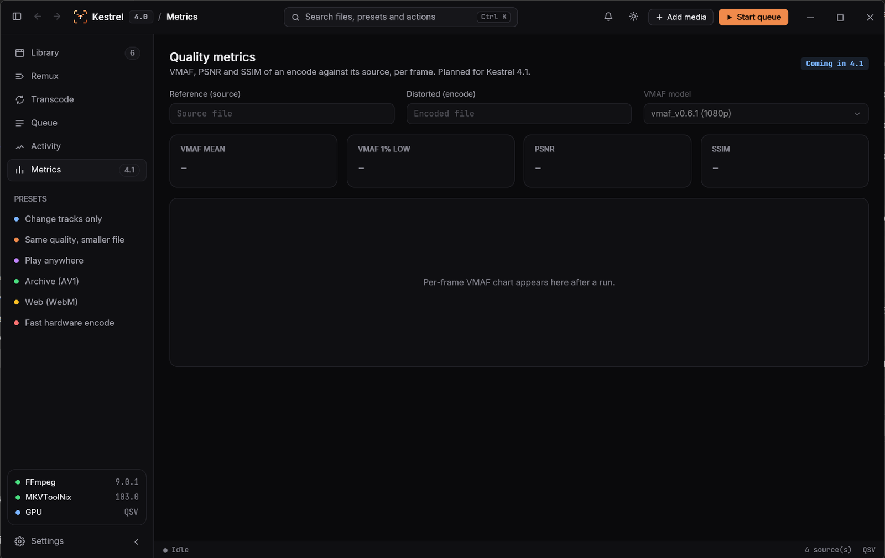

# Kestrel roadmap

What shipped, what comes next. Back to the [README](../README.md).

## 4.0 (done, not yet tagged)

Kestrel 4.0 is merged to `main`. The 4.0 app is the GPUI desktop app in `crates/kestrel-gpui`, on top of a reworked `kestrel-core`.

- **New app.** A GPUI desktop app with a Library, Remux, Transcode, Queue, Activity, Metrics (disabled) and Settings page, dark, light and system themes, a command palette (`Ctrl K`) and keyboard shortcuts.
- **Remux track editor.** Per file: keep or drop each track, edit language, title, default and forced flags. Language chips for batches. Output to MKV, MP4, MOV or WebM with warnings before anything is dropped. MKVToolNix and FFmpeg engines. Dry run and collision policy (rename, skip, overwrite).
- **Add tracks from files.** External SRT, ASS, SSA, VTT and SUP subtitles and external audio files muxed into a remux, with language guessed from the file name. The engines support timing offset and character set; the Remux page does not expose them yet.
- **HandBrake-level Transcode.** Eight tabs: Summary, Dimensions, Filters, Video, Audio, Subtitles, Chapters, Tags. Encoders: x264, x265 (8, 10, 12-bit), SVT-AV1, libaom, VP9, and NVENC, QSV, AMF, VideoToolbox and VAAPI where the FFmpeg build and the device allow. Constant quality or average bitrate with two-pass. Crop, scale, borders, rotation, deinterlace, detelecine, denoise, sharpen, deblock, colourspace, HDR10 keep or tone-map to SDR. Per-track audio with passthru rules. Subtitle import and burn-in. Chapter renaming. Tags.
- **Queue, Activity and presets.** Job snapshots, retry, reveal output, a command log you can copy or export, five built-in presets plus a hardware preset, and user presets.
- **Hardening.** 260 tests pass on Windows, including real FFmpeg integration tests for the transcode controls and remux edits.

### Known gaps in 4.0

- No tagged release. Build from source.
- macOS and Linux builds are untested.
- Tool paths cannot be overridden in Settings.
- Parallel jobs, process priority and keep source dates are saved but not applied.
- The Remux page has no offset, character set or reorder control.
- User presets cannot be renamed, deleted, imported or exported from the app.
- The Transcode preview is disabled.
- The egui app is still in the repository (removal was deferred).

## 4.1: quality metrics

The Metrics page becomes real. It measures an encode against its source with FFmpeg's filters. The 4.0 placeholder looks like this:

- Metrics: VMAF, PSNR, SSIM and XPSNR.
- One reference compared with many encodes in one run.
- Per-frame graphs you can zoom.
- VMAF model chosen automatically from the resolution.
- Analysis of a partial range of the video.
- Export of the worst frames as PNG images.
- CSV export, per frame and as a summary.
- A command log for every analysis.

This also brings the Transcode preview (short encode of a segment with before and after frames).

## Later

Candidates, not scheduled.

- Tool path overrides, and applying the parallel jobs and priority settings.
- Offset, character set and reorder controls on the Remux page.
- Preset management in the app (rename, delete, import, export).
- Watch folders that process new files automatically.
- Signed and notarised macOS builds, Linux packages, and a signed Windows installer.
- Removal of the legacy egui app.
- A command-line interface that shares `kestrel-core`.
