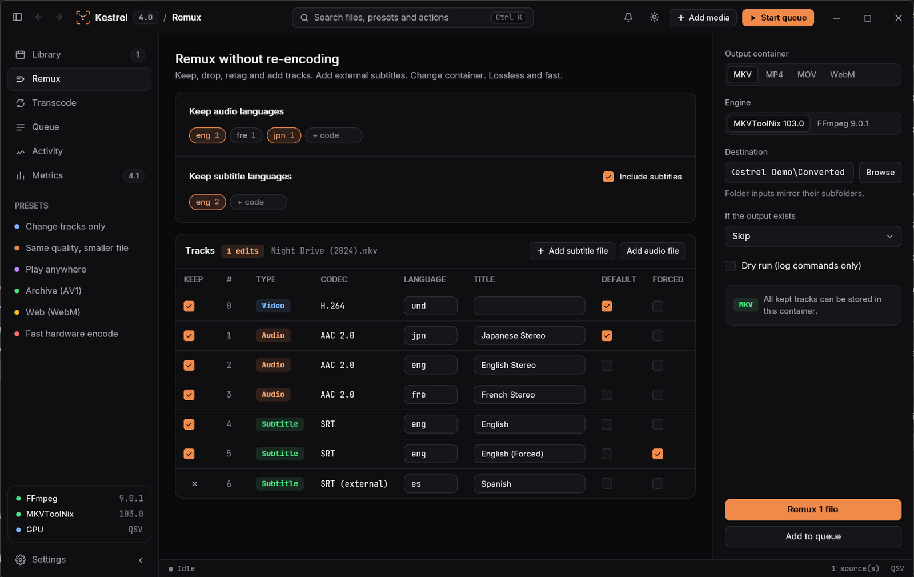
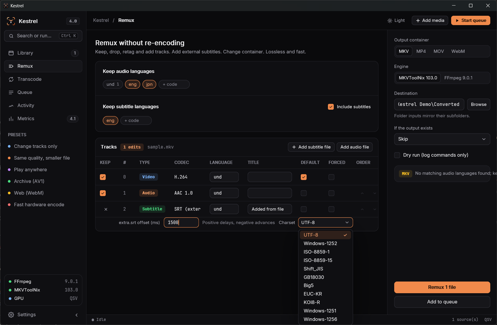
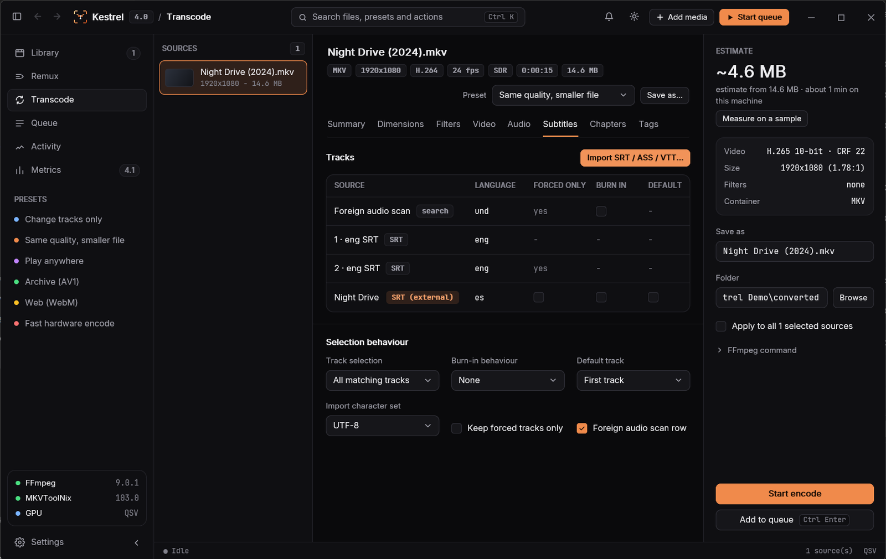

# Adding subtitles and audio

This guide covers adding external subtitle and audio files to a file, either in a remux (no re-encoding) or in a transcode (import and burn-in). Back to the [README](../../README.md).

## Add a file in a remux

On the Remux page, pick the source file in the menu above the track table, then press **Add subtitle file** or **Add audio file**. You can select several files at once. Each file appears as a new row after the source tracks, tagged with its kind and the file extension plus "(external)".

Accepted files:

| Kind | Extensions in the picker |
|---|---|
| Subtitle | `srt`, `ass`, `ssa`, `vtt`, `sup` |
| Audio | `aac`, `ac3`, `eac3`, `dts`, `flac`, `mka`, `m4a`, `mp3`, `ogg`, `opus`, `wav`, `thd` |

Kestrel probes each added file with `ffprobe`, so a `.mka` or `.thd` file shows its real codec and channel layout. If a file cannot be probed, Kestrel falls back to the extension.

Edit the new row like any other track:

- **Language** is guessed from the file name. `movie.es.srt` gives `spa`; `movie.eng.ass` gives `eng`; a name without a code gives `und`. Common two-letter codes convert to three letters. Fix it if the guess is wrong.
- **Title** starts as "Added from file". Change or clear it.
- **Default** makes it the default track of its type and clears the flag on the others.
- **Forced** marks forced display.
- The **Order** buttons move the row up or down, like a source track.
- The **x** button removes the added file from the job.
- Under each added row, **Offset (ms)** shifts the track in time, and **Charset** sets the text encoding of a text subtitle. See the next section.

The same container rules as for source tracks apply. A `.sup` (picture) subtitle goes into MKV only. An audio file the container cannot hold is dropped with a warning.

Added files are part of that source file's edits. They are not shared between files. For a batch, add the subtitle to each file separately.

## Timing offset and character set

Every added file has an **Offset (ms)** field under its row. A positive value delays the track and a negative value advances it. The hint "Positive delays, negative advances" sits beside the field.

An added text subtitle (SRT, ASS, SSA or VTT) also has a **Charset** menu. It lists UTF-8 (default), Windows-1252, ISO-8859-1, ISO-8859-15, Shift_JIS, GB18030, Big5, EUC-KR, KOI8-R, Windows-1251 and Windows-1256. Pick the one that matches the file if accents or other characters look wrong. Picture subtitles and audio files have no charset.

The engines apply them like this:

- **MKVToolNix:** `--sync 0:<seconds>` for the offset and `--sub-charset 0:<name>` for the character set.
- **FFmpeg:** the offset shifts the input timestamps, and a non-UTF-8 character set makes FFmpeg decode and re-encode the subtitle text (`-sub_charenc`). UTF-8 is the default.

## Import subtitles in a transcode

On the **Subtitles** tab of the Transcode page, press **Import SRT / ASS / VTT...**. The picker accepts `srt`, `ass`, `ssa` and `vtt`. Imported files join the track list, and they stay in it when you switch to another source.

Per-track columns:

| Column | Meaning |
|---|---|
| Language | Language code written to the output track. |
| Forced only | For an imported file, flags the output track as forced. For an embedded track, it shows the source's forced flag. |
| Burn in | Render this track into the video instead of storing it as a separate track. Only one track can be burned in. |
| Default | Mark it the default subtitle track. |
| Offset (ms) | Shift the subtitle in time. Positive delays it. |

**Import character set** sets the text encoding of imported files: UTF-8 (default), Windows-1252, ISO-8859-1 or Shift_JIS. Pick it before the encode if the accents or kana look wrong.

Imported subtitles in a transcode are subject to the container too. Text subtitles convert to `mov_text` for MP4 and MOV, and to WebVTT for WebM. Picture subtitles (`sup`, `idx`) only fit MKV, so burn them in for other containers.

Transcode jobs do not accept external audio files. Use the Remux page to add one.

## Burn-in

Burn-in draws the subtitle onto the video frames. Players cannot turn it off, and it needs a video re-encode. With **Passthru (copy video)** selected, Kestrel warns that "Subtitle burn-in needs the video to be re-encoded".

Set the behaviour with **Burn-in behaviour**:

| Choice | What gets burned |
|---|---|
| None | Nothing. Subtitles stay as separate tracks. |
| Foreign audio subtitle track | A forced subtitle that translates foreign-language speech. |
| First selected track | The first subtitle track that your selection keeps. |
| Foreign audio, then first track | The foreign-audio track if one exists, otherwise the first selected track. |

Imported files marked **Burn in** take priority over these choices.

### How "foreign audio" works

HandBrake scans the audio for foreign speech. FFmpeg cannot do that, so Kestrel approximates it. It looks for a subtitle track that is flagged forced and has the language of your primary (first selected) audio track. If none matches, it falls back to any forced track among the selected ones. The **Foreign audio scan row** option adds a search row at the top of the track list so you can see and control this choice. It is on by default.

This is an approximation. Files whose forced track is not flagged forced will not be found. Pick **First selected track** or mark an imported file with **Burn in** in that case.

Text subtitles are converted to ASS and drawn with FFmpeg's `subtitles` filter. Picture subtitles are overlaid on the video. In both cases the burned track is left out of the soft subtitle tracks.

## Related

- [Remux and the track editor](remux.md)
- [Transcode, tab by tab](transcode.md)
- [Troubleshooting](troubleshooting.md) for character set problems
