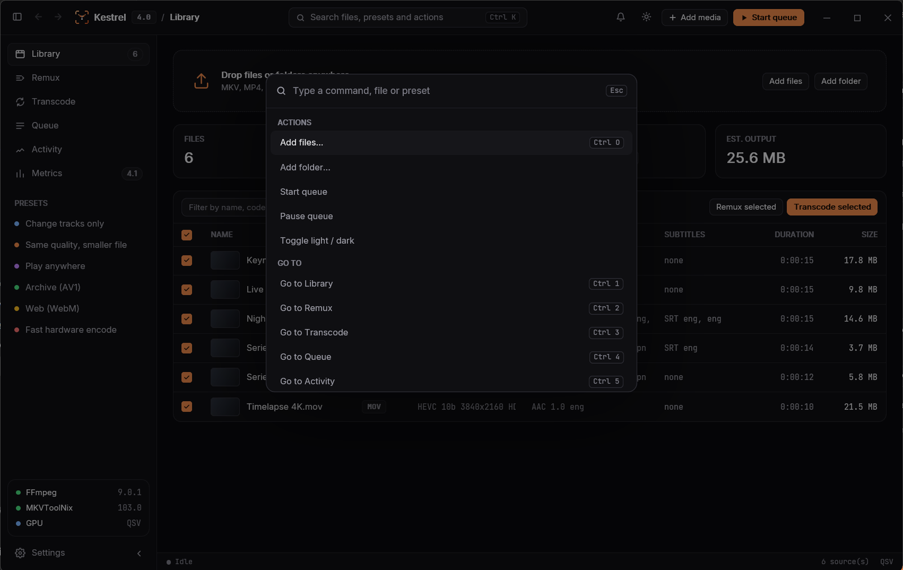
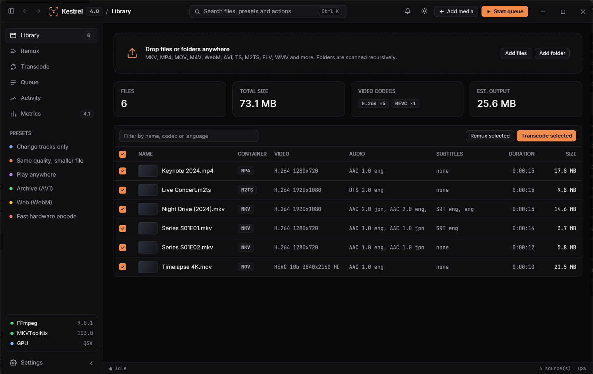
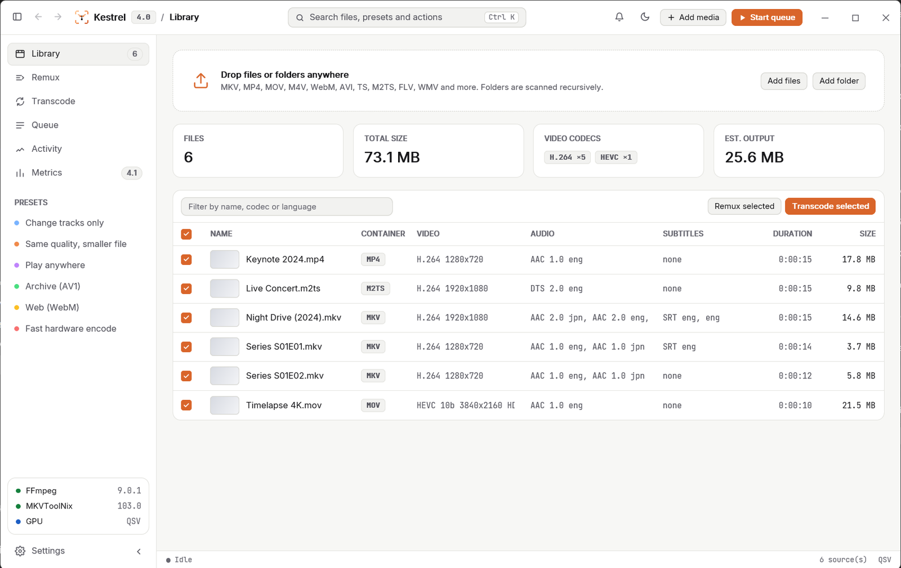

# Getting started

This guide takes you from a fresh build to your first remux and your first transcode. Back to the [README](../../README.md).

## Before you start

Kestrel 4.0 has no tagged release yet, so you build it from source. Follow [Build from source](../../README.md#build-from-source), and install FFmpeg (with FFprobe) and MKVToolNix first. Open **Settings** after the first launch. Each tool should show a version badge. If one shows `missing`, see [Troubleshooting](troubleshooting.md).

## The window

The sidebar lists seven pages.

| Page | Shortcut | Use it to |
|---|---|---|
| Library | `Ctrl 1` | Add files and folders and read what is in them |
| Remux | `Ctrl 2` | Keep, drop, edit and add tracks without re-encoding |
| Transcode | `Ctrl 3` | Re-encode video and audio |
| Queue | `Ctrl 4` | Run and watch jobs |
| Activity | `Ctrl 5` | Read commands, warnings and errors |
| Metrics | `Ctrl 6` | Placeholder for 4.1; it does nothing yet |
| Settings | none | Check tools, hardware encoders and appearance |

`Ctrl K` opens the command palette. It lists actions (add files, add a folder, start or pause the queue, toggle light and dark), every page, and every preset.

## 1. Add media

Drop files or folders on the window, press `Ctrl O`, or use **Add files** and **Add folder**. You can also start Kestrel with file paths: `kestrel-gpui movie.mkv`.

Kestrel accepts `mkv`, `mk3d`, `webm`, `mp4`, `m4v`, `mov`, `avi`, `ts`, `m2ts`, `mts`, `wmv`, `flv`, `mpg`, `mpeg`, `vob`, `3gp` and `ogv`. A folder adds every supported file inside it, including subfolders.

Each file is probed in the background. Rows show the container, video codec, audio tracks, subtitle tracks, duration and size. The cards above the table sum up the file count, total size and video codecs. The filter box matches on name, codec or language. Tick the rows you want to act on.

## 2. First remux: keep one language, change nothing else

1. Tick a file in the Library and press **Remux selected** (or press `Ctrl 2`).
2. Under **Keep audio languages**, click the language chips you want. Under **Keep subtitle languages**, do the same. No selection keeps every language.
3. Leave **Output container** on MKV and **Engine** on MKVToolNix.
4. Press **Remux 1 file**. Kestrel writes the result to a `converted` folder next to the source unless you set a destination.

The video stream is copied. The job takes about as long as copying the file.

Details, including the track editor, are in the [Remux guide](remux.md).

## 3. First transcode: smaller HEVC file

1. Tick a file and press **Transcode selected** (or press `Ctrl 3`).
2. In the **Preset** menu, choose **Same quality, smaller file**.
3. Check the **Video** tab. The encoder reads H.265, and the quality slider shows CRF 20.
4. Press **Start encode**. The job runs from the Queue.

Press **Add to queue** (or `Ctrl Enter`) instead if you want to queue several jobs and start them together. Details for every tab are in the [Transcode guide](transcode.md).

## 4. Watch it run

**Queue** shows each job with a progress bar, ETA and elapsed time. **Activity** logs the exact FFmpeg or mkvmerge command for every job, plus warnings and errors. If something fails, read Activity first.

## Where Kestrel stores your settings

Kestrel saves the window state, language choices, current transcode settings, user presets and the Settings page to `gpui.ron` in a `kestrel` folder inside your operating system's config directory (on Windows, `%APPDATA%\kestrel`).

## Next

- [Remux and the track editor](remux.md)
- [Adding subtitles and audio](adding-subtitles.md)
- [Transcode, tab by tab](transcode.md)
