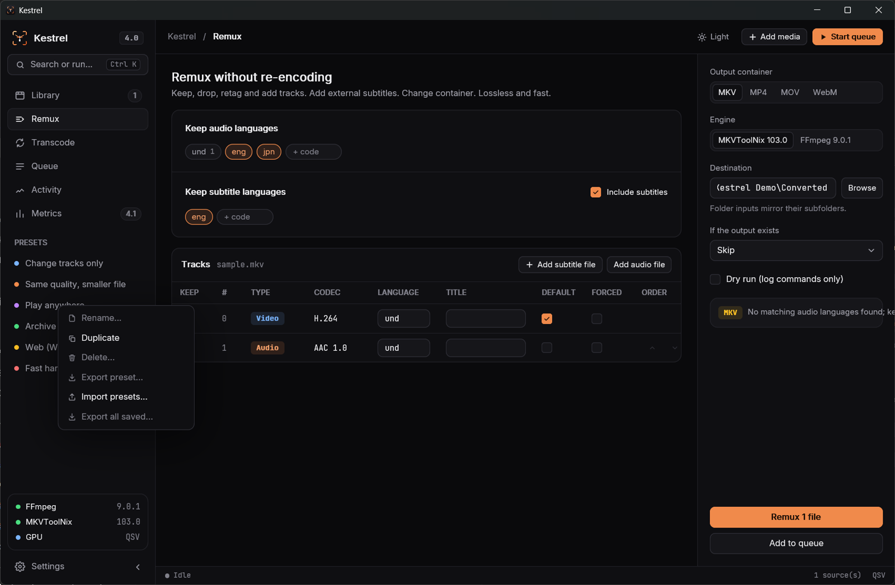

# Presets

This guide lists the built-in presets, what each one sets, and how to save your own. Back to the [README](../../README.md).

A preset is a saved set of Transcode settings (container, video, audio, subtitles and the rest). Loading one fills in every tab. You can then change anything before you encode.

## Use a preset

- On the Transcode page, pick one from the **Preset** menu.
- Or press `Ctrl K`, type part of the name and choose **Apply preset: ...**. This also opens the Transcode page.

The last preset name stays selected until you load another one. Editing a control does not rename the preset; **Save as...** stores the new state.

## Built-in presets

Quality values below are the encoder's own number: CRF for software encoders.

| Preset | Container | Video | Audio | Other |
|---|---|---|---|---|
| Change tracks only | MKV | Copy, no re-encode | Passthru | Copies streams and selects tracks. This is the same as a remux. |
| Same quality, smaller file | MKV | x265, CRF 20, preset `fast` | Passthru where the container allows | A general-purpose HEVC conversion. |
| Play anywhere | MP4 | x264, CRF 20, preset `fast`, limit 1080p, HDR tone-mapped to SDR | AAC 160 kbit/s, stereo | Burns in the foreign audio subtitle (forced track) so it plays on any device. |
| Archive (AV1) | MKV | SVT-AV1 10-bit, CRF 29, preset 6 | Passthru | A high-efficiency archive. Slow to encode. |
| Web (WebM) | WebM | VP9, CRF 31, `cpu-used` 3, limit 1080p | Opus 128 kbit/s, stereo | For web and Discord use. |
| Fast hardware encode | MKV | First detected hardware HEVC encoder, CQ 24 | Passthru | Appears only when a hardware HEVC encoder was detected. |

Check the Video tab after loading a preset. A preset that names an encoder your FFmpeg does not have shows that encoder marked "(not available)". At run time Kestrel substitutes an available encoder of the same codec, preferring software, or reports the missing encoder and does not start the job.

## Save your own

1. Set up the tabs the way you want.
2. Press **Save as...** next to the Preset menu (or use the palette).
3. Type a name and press **Save preset**.

The preset appears in the menu and in the palette. Kestrel saves your presets with its other settings in `gpui.ron` (see [Settings](settings.md)), so they survive a restart.

## Manage presets

Open the preset menu with the three-dot button beside **Save as...** on the Transcode page, or right-click a preset in the sidebar. It holds:

| Item | What it does |
|---|---|
| Rename... | Renames a saved preset. |
| Duplicate | Copies any preset, built-in or saved, under a new name. This is how you start from a built-in. |
| Delete... | Deletes a saved preset after a confirmation. This cannot be undone. |
| Export preset... | Writes the selected preset to a JSON file. |
| Import presets... | Reads one or more presets from a JSON file. |
| Export all saved... | Writes every saved preset to one JSON file. |

Built-in presets are read-only. Rename, Delete and Export are greyed out for them. Duplicate one to get an editable copy.

The file format is JSON with a `version` of 1. Imported presets are added to your list and do not replace existing ones.

## Related

- [Transcode, tab by tab](transcode.md)
- [Quality and encoder guidance](transcode.md#choosing-a-quality-value)
