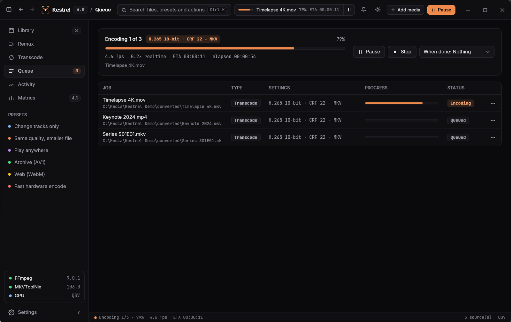
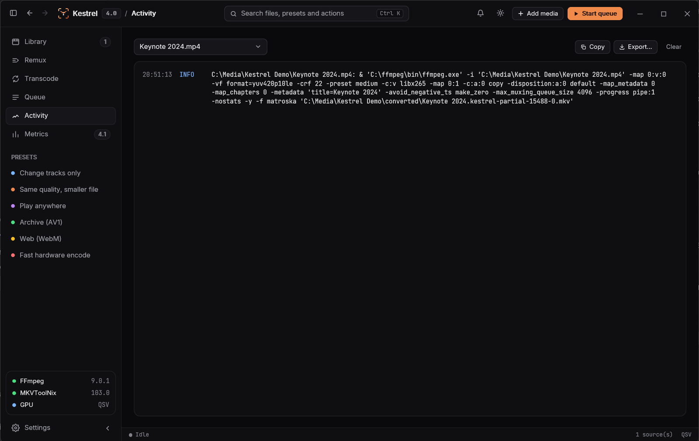

# Queue and Activity

This guide covers running jobs from the Queue page and reading what happened on the Activity page. Back to the [README](../../README.md).

## Queue

Every remux and transcode goes through the queue. Press **Add to queue** on the Remux or Transcode page, or `Ctrl Enter`. The buttons that say **Remux N files** and **Start encode** queue the job and start the queue at once.

Each row shows the file name, the job type (Remux or Transcode), a settings summary, a progress bar and the status. While a job runs, the row shows the position, the percentage, elapsed time and ETA.

Statuses: Queued, Encoding, Done, Skipped, Failed and Cancelled. Failed jobs carry the error message.

A job keeps the settings it had when you queued it. Changing the page afterwards does not change queued jobs.

### Controls

- **Start**, **Pause** and **Resume** control the queue. Pause lets the running job finish, then holds the next one.
- **Stop** (the button in the header, or **Stop** in a row's menu) cancels the running job, or a queued one. Kestrel removes the cancelled job's temporary file. Jobs that already finished keep their outputs.
- **Clear finished** removes completed rows from the list.
- Each row has a menu (the three-dot button) with **Retry** (for a failed, cancelled or skipped job), **Remove** and **Reveal output** (shows the output file in your file manager).
- **When done**: Nothing, Notify, or Open output folder. Notify shows a toast. Open output folder reveals the last output.

The Queue page has no reorder control in 4.0. Jobs start in the order you added them. With **Parallel jobs** above 1 in [Settings](settings.md#behaviour), several jobs run at the same time.

### Queue status in the top bar

While the queue runs, a pill in the [top bar](getting-started.md#the-top-bar) shows the progress, the current file, the percentage and the ETA, with a pause button. When the queue ends, the pill shows done or failed for 10 seconds. The **Start queue** button in the bar becomes **Pause** while jobs run, and **Resume** while it is paused.

## Activity

Activity logs, per job, what Kestrel did:

| Level | Meaning |
|---|---|
| CMD | The exact FFmpeg or mkvmerge command line that ran. |
| INFO | Progress and status messages. |
| DONE | A job or the queue finished. |
| WARN | Something was changed or skipped, such as a dropped track or a fallback. |
| ERROR | A job failed. The tool's own message is included. |

A bell in the top bar shows how many warnings and errors you have not read. Opening Activity clears the count.

Use **All jobs** to filter to one file. **Copy** puts the visible log on the clipboard. **Export...** saves it as `kestrel-activity.log`. **Clear** empties it. The log lives in memory and is cleared when you close the app.

When a job fails, read Activity before anything else: the command line shows what Kestrel asked the tool to do, and the error line shows what the tool said. See [Troubleshooting](troubleshooting.md).

## Dry run

Dry run on the Remux page logs the commands without writing media. It applies to the queue that run starts. A dry run does not prove the real job works.

## Related

- [Remux and the track editor](remux.md)
- [Transcode, tab by tab](transcode.md)
