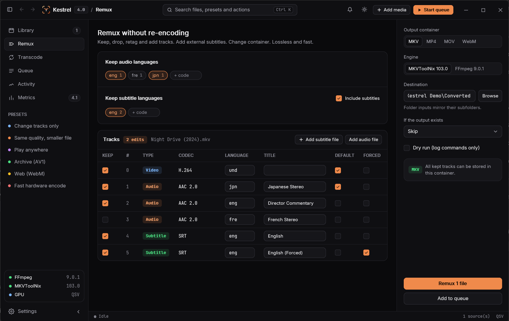
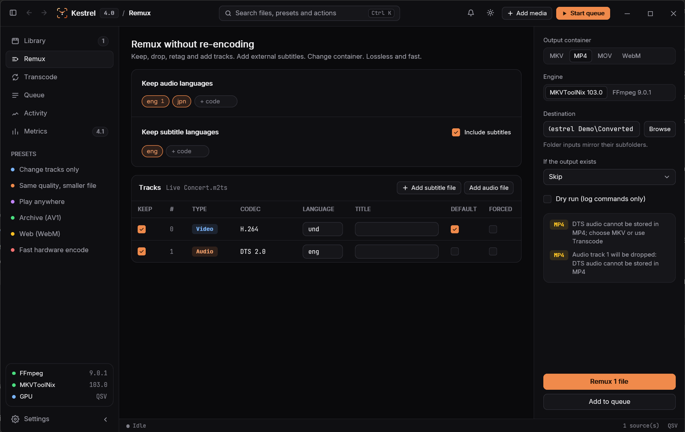

# Remux and the track editor

This guide covers the Remux page: choosing languages, editing individual tracks, picking a container and an engine, and what happens when the container cannot hold a track. Back to the [README](../../README.md).

A remux copies streams into a new file. Nothing is re-encoded, so quality is unchanged and the job is fast. The one exception is text subtitles, which are converted to the container's text format when the container requires it.

## Languages

The two language cards list every language found in the files you selected, with a count. Click a chip to toggle it.

- **Keep audio languages** and **Keep subtitle languages** are independent.
- No chip selected means all tracks of that kind are kept.
- If you select audio languages and a file has none of them, Kestrel keeps all audio tracks of that file and warns you.
- Tracks without a language tag count as `und`.
- Type a code into the `+ code` box to add a language no file carries (two or three letters, for example `fr` or `fra`). Languages are matched by their ISO 639-2 code.
- **Include subtitles** off drops every subtitle track.

Language selection runs first. The track editor then refines the result: it can drop more tracks, but it cannot bring back a track that the language selection excluded.

## The track editor

Pick a file in the menu above the table (it lists the files in your Library). The table shows every video, audio and subtitle track of that file.

| Column | What it does |
|---|---|
| Keep | Untick to drop the track from the output. |
| `#` | Track number within its type. |
| Type | Video, Audio or Subtitle. |
| Codec | The codec, plus the channel layout for audio. |
| Language | Edit the language code. Use a three-letter ISO 639-2 code such as `eng` or `jpn` (`und` is allowed). Common two-letter codes such as `en` are converted. Anything that is not a valid code fails the job before any tool starts. |
| Title | The track name. Clear it to remove the name. |
| Default | Marks the track the player picks first. |
| Forced | Marks a track for forced display, usually foreign-language dialogue. |
| Order | Up and down buttons that move the track one place earlier or later. |

The header shows how many edits differ from the source file. Kestrel records only the fields you changed, so untouched tracks keep their source values.

Rules that apply to the whole file:

- **One default per type.** If you set Default on a track, every other track of that type loses the flag. If you set it on several, the last one in output order wins. If you set none, the first source default stays and later ones are cleared. If you drop the default track, Kestrel does not promote another one.
- **Order.** Source tracks keep their original order until you change it. Tracks you add from files (see [Adding subtitles and audio](adding-subtitles.md)) go after them, in the order you added them. Use the up and down buttons in the **Order** column to move any source or added row. The order you set is the order of the tracks in the output, within each type.

## Output container

Choose **MKV**, **MP4**, **MOV** or **WebM**. Under the container menu, Kestrel shows either a green note ("All kept tracks can be stored in this container") or one warning per problem track.

What each container can hold without conversion:

| Container | Video | Audio | Subtitles |
|---|---|---|---|
| MKV | any | any | text and picture |
| MP4 | H.264, HEVC, AV1, MPEG-4, VP9 | AAC, AC3, E-AC3, MP3, Opus, FLAC, ALAC | text only (`mov_text`) |
| MOV | H.264, HEVC, AV1, MPEG-4, MPEG-2 | AAC, AC3, E-AC3, MP3, ALAC, PCM | text only (`mov_text`) |
| WebM | VP8, VP9, AV1 | Opus, Vorbis | text only (WebVTT) |

What Kestrel does when a track does not fit:

| Track | Action |
|---|---|
| Video the container cannot hold | The job fails with "Video must be re-encoded". Use [Transcode](transcode.md). |
| Audio the container cannot hold (for example DTS in MP4) | The track is dropped, and a warning names it. If no audio track is left, the job fails. A remux never converts audio. |
| Text subtitles in MP4, MOV or WebM | Converted to `mov_text` or WebVTT. |
| Picture subtitles (PGS, VobSub) in MP4, MOV or WebM | Dropped with a warning. Burn them in with Transcode, or choose MKV. |

Chapters and source metadata are carried over by default.

## Engine

- **MKVToolNix** runs `mkvmerge`. Kestrel uses it only when the input is Matroska, the output container is MKV and `mkvmerge` is installed.
- **FFmpeg** handles everything else: MP4, MOV and WebM output, non-Matroska inputs, and any job where `mkvmerge` cannot identify the tracks.

If you choose MKVToolNix for a job it cannot do, Kestrel quietly uses FFmpeg for that job. Check Activity to see which command ran.

## Destination and name collisions

- **Destination** empty means a `converted` folder next to each source. Use **Browse** to pick a folder. Folder inputs mirror their subfolders inside it.
- **If the output exists**:
  - **Rename** writes `name (2).mkv`, `name (3).mkv` and so on.
  - **Skip** leaves the existing file and reports the job as skipped.
  - **Overwrite** replaces it.

While a job runs, Kestrel writes to a temporary partial file and renames it on success. Stop and failure remove the partial file. Finished outputs stay.

## Dry run

Tick **Dry run (log commands only)** to plan the jobs without writing media. Activity shows the commands that would run. A dry run does not prove the real job will succeed.

## Running the job

- **Remux N files** queues the selected files and starts the queue at once.
- **Add to queue** queues them and waits. Press `Ctrl Enter` for the same.

Each queued job keeps a snapshot of its settings. Later edits on the page do not change jobs already queued.

Next: [Adding subtitles and audio](adding-subtitles.md), [Queue and Activity](queue-and-activity.md).
