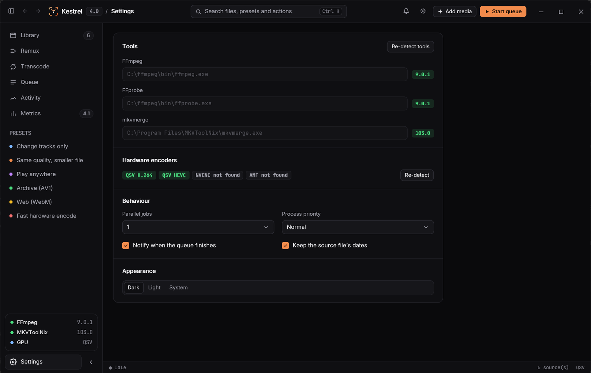
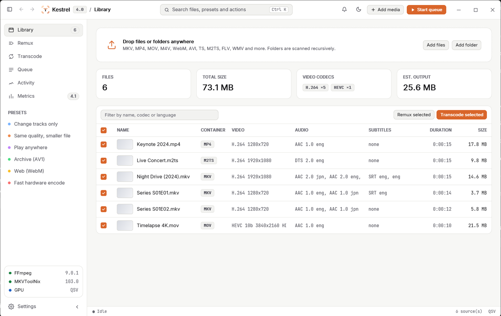

# Settings

This guide covers the Settings page: tool detection, hardware encoders, behaviour options and appearance. Back to the [README](../../README.md).

## Tools

Settings lists FFmpeg, FFprobe and mkvmerge with the path Kestrel found and a badge:

- A version badge (for example `7.1`) means the tool was found and answered `-version`.
- `unknown` means the file exists but its version could not be read.
- `missing` means Kestrel found nothing.

Kestrel searches in this order:

1. The folder of the Kestrel executable, then a `tools` folder beside it, then folders one and two levels below `tools`.
2. Every folder on `PATH`.
3. Platform defaults. Windows: `C:\Program Files\MKVToolNix` (mkvmerge only). macOS: `/Applications/MKVToolNix-*.app`, then `/opt/homebrew/bin` and `/usr/local/bin`. Linux: `/usr/bin` and `/usr/local/bin`.

The path fields are read-only in 4.0. To use a different build, put it first on `PATH` or beside the executable, and press **Re-detect tools**. Kestrel also re-runs encoder detection.

What needs which tool:

| Tool | Needed for |
|---|---|
| FFprobe | Reading every file that is not Matroska, and the fallback when mkvmerge cannot identify a file |
| FFmpeg | All transcodes, all MP4, MOV and WebM output, and remuxes that mkvmerge cannot do |
| mkvmerge | Optional. MKV to MKV remuxes when the MKVToolNix engine is chosen |

## Hardware encoders

At startup Kestrel runs `ffmpeg -encoders`, then test-encodes one tiny frame with each hardware encoder it finds (10 second limit each). Only encoders that pass appear in the Video tab. The page shows a badge per working encoder, for example `NVENC HEVC`, and a `not found` badge for each vendor with none. Vendors checked: NVENC, QSV, AMF, VideoToolbox and VAAPI, each with H.264, HEVC and AV1.

Press **Re-detect** after installing a driver or switching the FFmpeg build. A red message above the badges means encoder detection failed; the text says why.

## Behaviour

| Option | What it does |
|---|---|
| Notify when the queue finishes | Shows a toast when the queue ends. |
| Parallel jobs | How many queue jobs run at once, 1 to 4. With more than one, each job writes its own output file. |
| Process priority | Normal, Below normal or Low. Applies to every FFmpeg, FFprobe and mkvmerge process Kestrel starts. Use Low to keep the computer responsive during a long encode. |
| Keep the source file's dates | Gives each output the source file's modified and accessed times. If Kestrel cannot copy them, Activity logs it and the job still finishes. |

All four keep their value across restarts.

## Appearance

**Dark**, **Light** or **System**. System follows the operating system and changes with it.

## Where settings are saved

Kestrel writes `gpui.ron` to a `kestrel` folder in your config directory (`%APPDATA%\kestrel` on Windows). The file holds the language chips, Remux options, the current Transcode settings, user presets, Settings page values and the theme. Writes are debounced and atomic.

## Related

- [Troubleshooting](troubleshooting.md)
- [Presets](presets.md)
