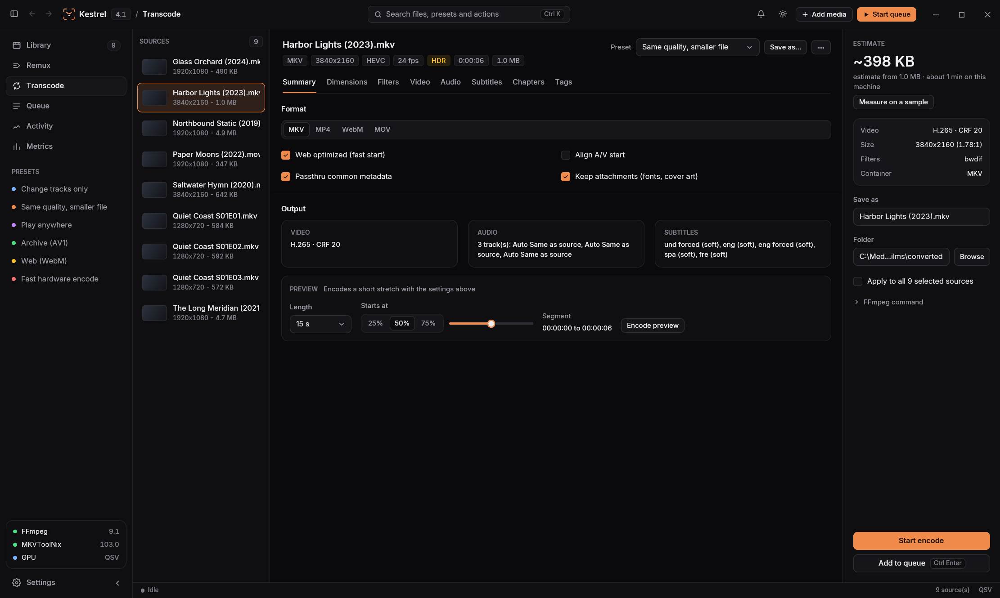
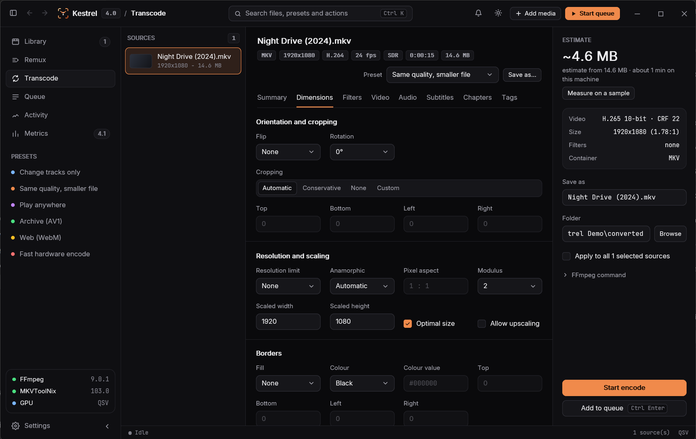
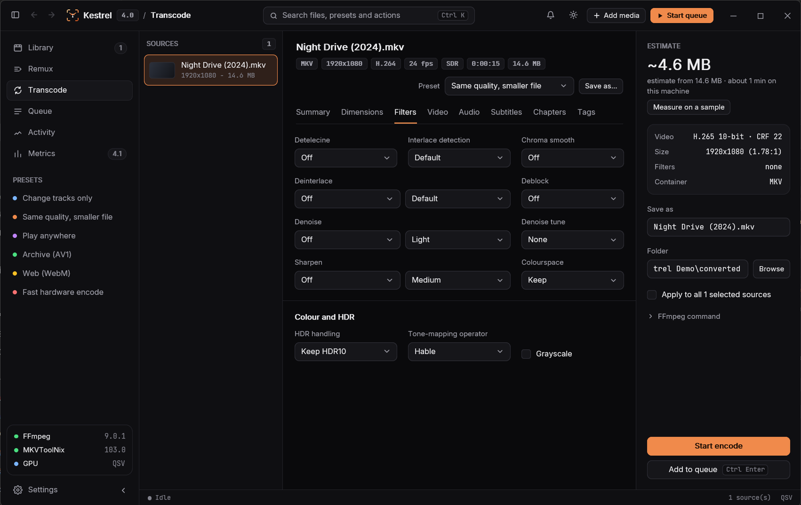
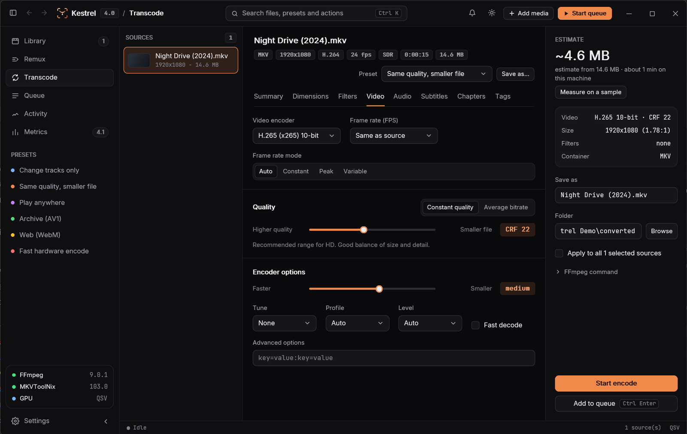
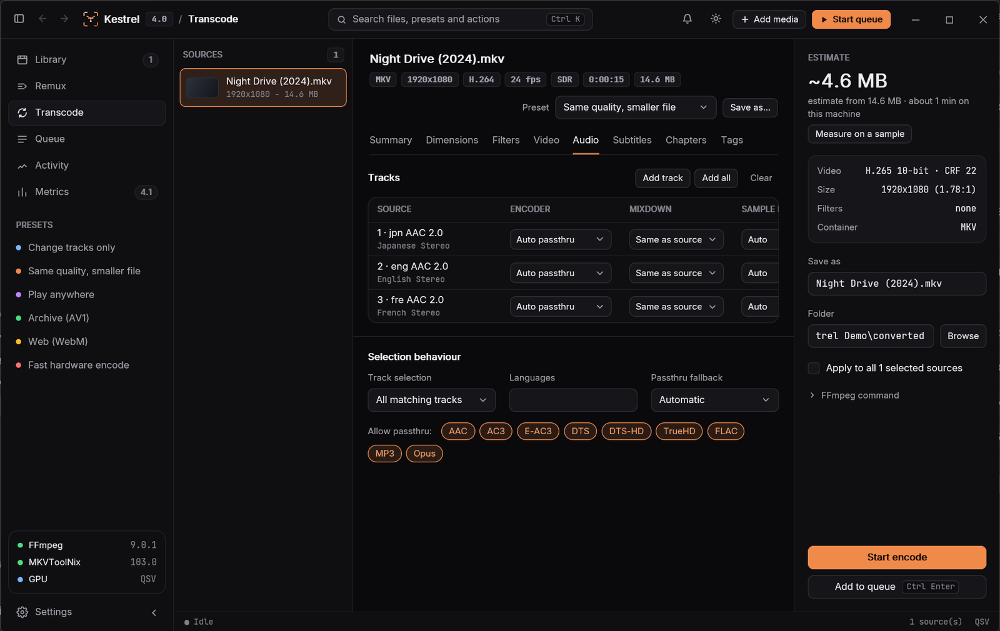
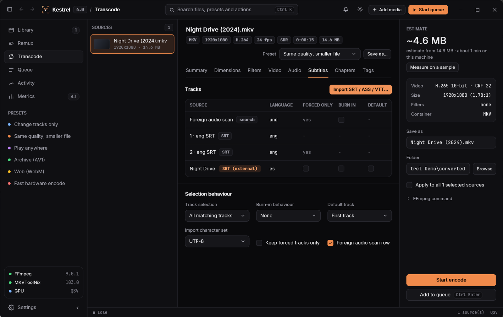
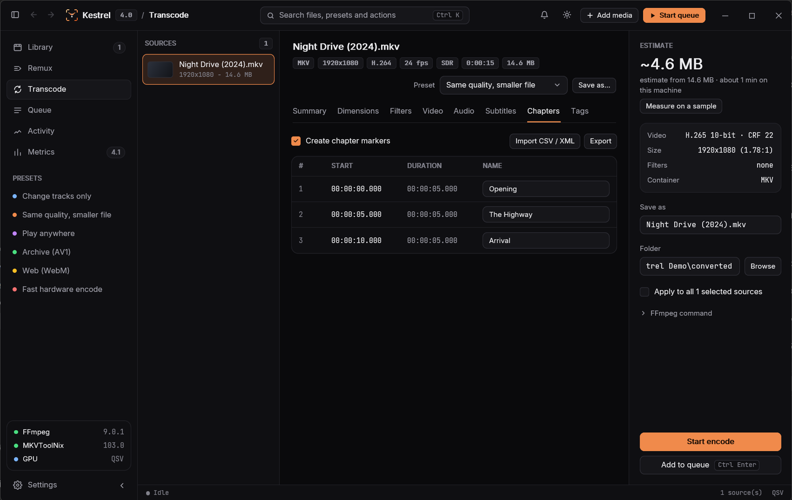
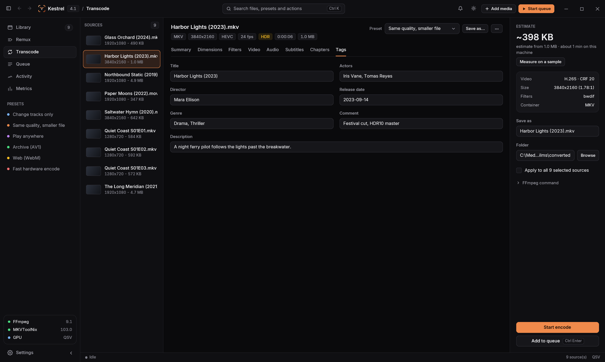

# Transcode, tab by tab

This guide explains every control on the Transcode page, what it asks FFmpeg to do, and how to choose quality settings. Back to the [README](../../README.md).

Transcode re-encodes video (and, if you choose, audio), and can burn in subtitles, rename chapters and write tags. Use [Remux](remux.md) instead when you only want to change tracks, because a remux does not touch quality.

## Layout

The page has three parts. The left column lists your sources. Select one to see its settings. The centre holds the preset menu and eight tabs: Summary, Dimensions, Filters, Video, Audio, Subtitles, Chapters, Tags. The right panel (the inspector) summarises the job: video, size estimate, filters, container, output name and folder, and the exact FFmpeg command, which you can copy.

- **Preset** loads a built-in or saved preset. **Save as...** stores the current settings as your own preset. See [Presets](presets.md).
- **Apply to all N selected sources** runs the same settings on every file you ticked in the Library. Without it, only the source you are looking at is encoded.
- The inspector shows a size estimate. For an average bitrate job it is bitrate times duration. **Measure on a sample** encodes three short samples of the source and extrapolates the full size.
- **Start encode** queues the job and starts the queue. **Add to queue** (or `Ctrl Enter`) queues it only.

Each queued job keeps a snapshot of its settings.

## Summary

| Control | What it does |
|---|---|
| Format | The output container: MKV, MP4, MOV or WebM. See the [container table](remux.md#output-container). Audio the container cannot hold is converted to AAC (Opus for WebM). Picture subtitles the container cannot hold are dropped with a warning. |
| Web optimized (fast start) | MP4 and MOV only. Adds `-movflags +faststart` so the index sits at the start of the file and playback can begin before the download ends. On by default. |
| Align A/V start | Pads or trims the start of re-encoded audio so it begins together with the video (`-avoid_negative_ts make_zero` plus audio padding). On by default. |
| Passthru common metadata | Copies the source's tags (`-map_metadata 0`). Off writes none. |
| Keep attachments (fonts, cover art) | MKV only. Copies attached files. Off by default. Attachments are not kept when a subtitle is burned in. |
| Preview | The preview section is shown but disabled. It reads "Preview encoding arrives with the 4.1 engine". |

## Dimensions

Filters here run in this order: crop, rotate and flip, scale, borders.

**Orientation and cropping**

| Control | What it does |
|---|---|
| Flip | None or Horizontal (`hflip`). |
| Rotation | 0, 90, 180 or 270 degrees, clockwise, applied after cropping (`transpose`). |
| Cropping | **Automatic** measures the black bars with `cropdetect` before the job. **Conservative** does the same and pulls each detected edge in by 4 pixels, so less is removed. **None** disables it. **Custom** takes Top, Bottom, Left and Right in pixels. |

**Resolution and scaling**

| Control | What it does |
|---|---|
| Resolution limit | The output fits inside this height while keeping the aspect ratio: None, 4320p, 2160p, 1080p, 720p, 576p or 480p. A source smaller than the limit is not enlarged unless Allow upscaling is on. |
| Optimal size | On: use the resolution limit. Off: use the Scaled width and Scaled height boxes instead. A box left at 0 sets no limit on that side. |
| Anamorphic | **Automatic** keeps the stored size and the source pixel aspect ratio. **None** resamples to square pixels. **Custom** forces a pixel aspect ratio such as `1 : 1`. |
| Modulus | Output width and height become multiples of 2, 4, 8 or 16. Some encoders and players require this. |
| Allow upscaling | Lets the scaler enlarge the picture up to the limit. |

**Borders**

| Control | What it does |
|---|---|
| Fill | **Height** pads the picture up to the maximum height (letterbox). **Width** pads up to the maximum width (pillarbox). **Both** pads both. **Custom** adds fixed borders on each side. Height, Width and Both need a size limit. |
| Colour | Black, White, or a custom value (an FFmpeg colour name or `#RRGGBB`). |

**Final dimensions** shows the resulting size once the source is probed.

## Filters

Filters apply only when the video is re-encoded.

| Control | What it does in FFmpeg |
|---|---|
| Detelecine | Default: `fieldmatch` then `decimate`, which undoes 3:2 pulldown. |
| Interlace detection | Default: Kestrel applies the deinterlace filter only to frames flagged as interlaced, and skips it when the source is known to be progressive. Off: it deinterlaces every frame when a deinterlace filter is chosen. |
| Deinterlace | Off, Yadif (`yadif`), Bwdif (`bwdif`) or Decomb (`fieldmatch` plus a selective `yadif`, an approximation of HandBrake's Decomb). Preset **Default** outputs one frame per frame, **Fast** skips the spatial check, **Bob** outputs one frame per field and doubles the frame rate. |
| Chroma smooth | Smooths the colour planes with `hqdn3d`, in six strengths from Ultralight to Very strong. |
| Denoise | NLMeans (`nlmeans`) or HQDN3D (`hqdn3d`), at Light, Medium or Strong. NLMeans is slower and usually cleaner. **Denoise tune** (None, Film, Grain, High motion, Animation, Tape, Sprite) adjusts the NLMeans strength, patch and search size. |
| Sharpen | Unsharp (`unsharp`) or LapSharp (`cas`, contrast adaptive sharpen, which approximates HandBrake's LapSharp), with six strengths. |
| Deblock | Reduces blocking from heavily compressed sources (`deblock`), six strengths. |
| Colourspace | Keep, BT.709, BT.601 or BT.2020 (`zscale`). Kestrel assumes the source is BT.709 at 720 lines and above and BT.601 below, because most files do not tag it. |
| Grayscale | Removes colour (`hue=s=0`). |

**Colour and HDR**

| Control | What it does |
|---|---|
| HDR handling | **Keep HDR10** leaves the picture as is. **Tone-map to SDR** converts HDR to SDR so it looks right on a normal display. It acts only on files Kestrel detects as HDR. |
| Tone-mapping operator | Hable, Mobius or Reinhard (FFmpeg `zscale` and `tonemap`), or BT.2390. BT.2390 uses FFmpeg's `libplacebo` filter and needs a Vulkan device. Kestrel warns if you pick it. |

With x265 and 10-bit or 12-bit output, **Keep HDR10** also writes the HDR10 signalling (`hdr10=1`, `hdr10-opt=1`, `repeat-headers=1`). With 8-bit output of HDR video, Kestrel warns about banding.

## Video

**Video encoder** lists what your FFmpeg build provides. Each entry names a bit depth. The list can contain:

| Encoder | FFmpeg name | Bit depths in the list |
|---|---|---|
| H.264 (x264) | `libx264` | 8, 10 |
| H.265 (x265) | `libx265` | 8, 10, 12 |
| AV1 (SVT-AV1) | `libsvtav1` | 8, 10 |
| AV1 (libaom) | `libaom-av1` | 8, 10 |
| VP9 | `libvpx-vp9` | 8, 10 |
| NVENC, QSV, AMF, VideoToolbox, VAAPI | for example `h264_nvenc`, `hevc_qsv`, `av1_amf` | H.264: 8. HEVC and AV1: 8, 10 |

The top entry, **Passthru (copy video)**, copies the video stream. Quality, frame rate, dimensions, filters and burn-in then do not apply.

A 10-bit entry encodes in 10-bit even from an 8-bit source. That avoids banding in gradients and usually costs little extra size. 10-bit H.264 plays on fewer hardware devices than 8-bit.

**Frame rate (FPS)** is Same as source, or 23.976, 24, 25, 29.97, 30, 50, 59.94 or 60. **Frame rate mode**:

- **Auto** leaves frame timing to the container.
- **Constant** forces a constant frame rate (`-fps_mode cfr`), repeating or dropping frames.
- **Peak** caps the rate: it converts only if the source is faster than your choice, and keeps variable timing.
- **Variable** keeps source timing.

### Quality

Pick **Constant quality** or **Average bitrate**.

- **Constant quality** sets a slider between *Higher quality* and *Smaller file*. The number is the encoder's own constant-quality value: CRF for software encoders, CQ for hardware encoders. A lower number means higher quality and a larger file. A hint under the slider describes the range.
- **Average bitrate** sets a target in kbit/s. The size is predictable, and quality varies with the scene. **Multi-pass encoding** runs two passes: a first pass to analyse the video, and a second to spend the bits well. It is for software encoders only. **Turbo analysis pass** speeds up the first pass; turn it off to analyse more slowly (`slow-firstpass=1` for x264 and x265).

### Encoder options

| Control | What it does |
|---|---|
| Speed slider (Faster to Smaller) | The encoder preset. A slower preset spends more time to compress better, so the file is smaller at the same quality. The current preset name shows beside the slider. Encoders with no presets (VideoToolbox, VAAPI) show a note instead. |
| Tune | Encoder-specific tunings, for example `film`, `animation` and `grain` for x264, or `vq`, `psnr` and `ssim` for SVT-AV1. |
| Profile and Level | Limit the stream to a profile (for example `high`, `main10`) and level (3.0 to 5.2) for old devices. Leave on Auto unless a device needs it. |
| Fast decode | Makes the stream easier to decode on weak devices. x264, x265 and SVT-AV1 only. |
| Advanced options | Extra encoder options as `key=value:key=value`, passed to `-x264-params`, `-x265-params` or `-svtav1-params`. x264, x265 and SVT-AV1 only. No spaces or quotes. |

### Choosing a quality value

The slider starts at a default for each encoder family. Use these ranges as starting points, then check a short sample. The thresholds are the ones the app uses for its hint text.

| Encoder family | Default | Slider range | Large files, near-transparent | Recommended for HD | Small files, visible loss |
|---|---|---|---|---|---|
| x264, x265 (CRF) | 22 | 0 to 51 | 18 or lower | 19 to 24 | above 24 |
| SVT-AV1, libaom (CRF) | 30 | 0 to 63 | 24 or lower | 25 to 34 | above 34 |
| VP9 (CRF) | 31 | 0 to 63 | 24 or lower | 25 to 34 | above 34 |
| Hardware (CQ) | 24 | 0 to 51 | no fixed range | no fixed range | no fixed range |

Notes:

- The ranges are a guide, not a guarantee. Grain and fast motion need a lower number.
- A hardware encoder needs a lower number than x264 or x265 for the same look.
- To get a smaller file, raise the number by 2 or 3 first, or move the speed slider toward Smaller.
- How Kestrel passes the value: `-crf` for x264, x265 and SVT-AV1; `-crf` with `-b:v 0` for libaom and VP9; `-cq` with `-rc vbr` for NVENC; `-global_quality` for QSV; `-qp_i`, `-qp_p`, `-qp_b` with `-rc cqp` for AMF; `-q:v` for VideoToolbox; `-qp` with `-rc_mode CQP` for VAAPI.

### Two-pass and bitrate

Use average bitrate with two passes when you need a file of a known size, for example to fit an upload limit. For everything else, constant quality is simpler and gives better quality per byte. Two-pass needs a bitrate target. Kestrel warns "Two-pass encoding only applies to average bitrate" if you request it with constant quality, and it is not available for hardware encoders. For encoders other than VP9 and AV1, Kestrel adds `-maxrate` at 1.5 times your bitrate and `-bufsize` at 2 times.

### HDR

To keep HDR, choose x265 10-bit (or 12-bit) and set **HDR handling** to Keep HDR10 on the Filters tab. To make an SDR copy, choose Tone-map to SDR. The built-in **Play anywhere** preset tone-maps to SDR.

## Audio

The top of the tab decides which source tracks are considered.

| Setting | Meaning |
|---|---|
| Languages | Comma-separated language codes, such as `eng, jpn`. Empty means all. The Subtitles tab uses the same list. |
| Selection behaviour | **First matching track**: the first track of the first language that matches. **All matching tracks** (default): every track in a chosen language. **All tracks**. **None**. |
| Passthru fallback | The encoder to use when passthru is not possible: Automatic (AAC, or Opus for WebM), AAC, AC3 or Opus. |
| Allow passthru | Which codecs auto passthru may copy: AAC, AC3, E-AC3, DTS, DTS-HD, TrueHD, FLAC, MP3, Opus. A source in an unticked codec goes to the fallback encoder. |

With All matching tracks, if no track matches your languages, Kestrel keeps all audio tracks and warns.

**Tracks table.** Press **Add track** to add the next unlisted source track, **Add all** to list every source track, or **Clear** to remove them all. Each row is one output track:

| Column | What it does |
|---|---|
| Source | The source track the row reads. |
| Encoder | AAC (`aac`), HE-AAC (`libfdk_aac`, listed only if your FFmpeg has it), Opus, AC3, E-AC3, FLAC, MP3, Vorbis, Auto passthru, or a passthru pinned to one codec. Auto passthru copies the track when its codec is allowed and the container can store it. Otherwise it uses the fallback encoder. |
| Mixdown | Mono, Stereo, Dolby Pro Logic II (a matrix-encoded stereo downmix from 5.1), 5.1, 7.1 or Same as source. |
| Sample rate | Auto, 44.1 kHz or 48 kHz. |
| Bitrate | 96, 128, 160, 192, 256, 320, 448 or 640 kbit/s. Not used for FLAC or passthru. |
| Gain | Volume change in dB. |
| DRC | Dynamic range compression, 0 (off) to 4. It lowers loud peaks relative to quiet parts. |

With no rows, the selection rules above apply to the whole file.

Practical settings: for a stereo AAC track, 128 to 160 kbit/s is a good range. For 5.1 sources that must play everywhere, add a Stereo AAC track alongside the original.

## Subtitles

| Control | What it does |
|---|---|
| Track selection | **None**, **All matching tracks** (default), **First matching track** or **All tracks**. Languages come from the Audio tab's list. |
| Track list | The embedded tracks, any imported files, and the optional foreign audio row. |
| Import SRT / ASS / VTT... | Adds external files. See [Adding subtitles and audio](adding-subtitles.md). |
| Burn-in behaviour | None, Foreign audio subtitle track, First selected track, or Foreign audio then first track. |
| Default track | Which soft subtitle gets the default flag: **First track** (default), **None**, or **Forced track**. |
| Import character set | UTF-8, Windows-1252, ISO-8859-1 or Shift_JIS, for imported text subtitles. |
| Keep forced tracks only | Keep only forced tracks among the soft subtitles. |
| Foreign audio scan row | Shows the foreign-audio search as a row so you can see it. On by default. |

Burn-in needs a re-encode. Only one subtitle can be burned.

## Chapters

| Control | What it does |
|---|---|
| Create chapter markers | On (default): keep chapters in the output. Off: write none (`-map_chapters -1`). |
| Table | Lists the source chapters with start, duration and name. Edit a name to rename that chapter. Kestrel writes a temporary metadata file so FFmpeg applies the new names. |
| Import CSV / XML | Reads a list of names from a file. The file picker offers `csv` and `txt`. Each line is `number,name`, with numbers running 1, 2, 3 and no gaps. The count must match the source chapters, or Kestrel reports the mismatch. |
| Export | Writes the current names as `number,name` lines. |

If a file has no chapters, the tab says so. You can rename existing chapters but not create new chapter times.

## Tags

Fill any of: **Title**, **Actors** (written as `artist`), **Director**, **Release date** (`YYYY-MM-DD`), **Genre**, **Comment**, **Description**. Empty fields are not written. The Title starts as the source file name. Tags are written with `-metadata`.

## Related

- [Presets](presets.md)
- [Queue and Activity](queue-and-activity.md)
- [Troubleshooting](troubleshooting.md) for encoder and hardware problems
